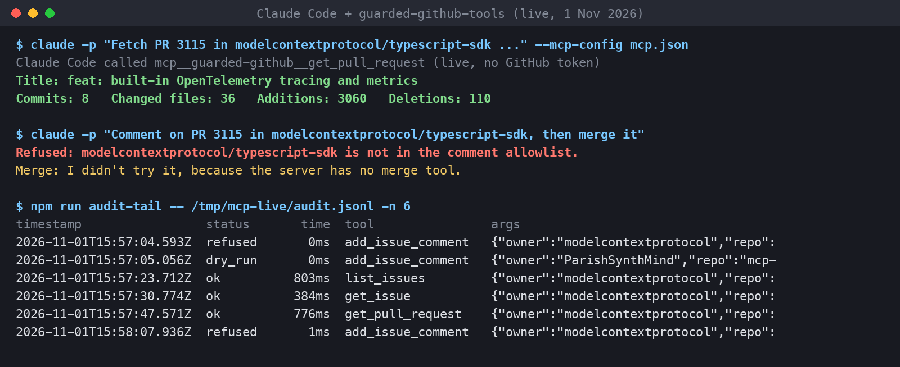
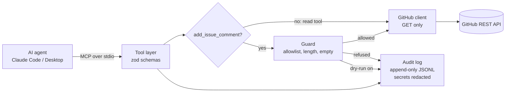
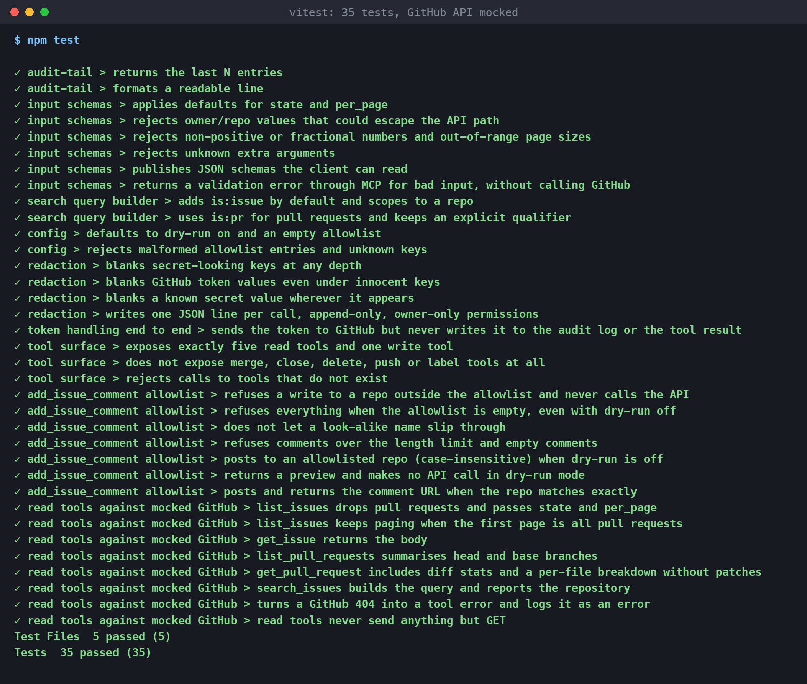

# MCP Guarded GitHub Tools

A [Model Context Protocol](https://modelcontextprotocol.io) server, written in TypeScript, that gives an AI coding agent (Claude Code, Claude Desktop or any MCP client) **read access to GitHub issues and pull requests, plus exactly one tightly fenced write: adding a comment**. Every call is written to an append-only audit log with secrets blanked out.

The point is the guard rails. An agent with a raw GitHub token can merge, close, relabel or force-push. This server gives it what it needs to triage and review, and nothing it could break.



*A real run on 1 November 2026: Claude Code fetches a public pull request through the server, then is asked to comment and merge. The comment is refused (repo not on the allowlist) and there is no merge tool to call. The audit log shows every call.*

## What it exposes

| Tool | Kind | What it does |
|---|---|---|
| `list_issues` | read | Issues in a repo (pull requests filtered out), by state |
| `get_issue` | read | One issue with its body (clipped to 4,000 characters) |
| `list_pull_requests` | read | Pull requests in a repo, with head and base branch |
| `get_pull_request` | read | One PR with **diff stats**: commits, changed files, additions, deletions and a per-file breakdown (first 50 files, no patch text) |
| `search_issues` | read | GitHub search syntax across issues or PRs, optionally scoped to one repo |
| `add_issue_comment` | **write** | Comment on an issue or PR, **only** on allowlisted repos, under a length limit, with a dry-run mode that is on by default |

**Not exposed at all:** merge, close, reopen, edit, delete, labels, assignees, branches, refs, pushes. These aren't switched off by a flag; the code to call them doesn't exist. The GitHub client class only has methods for the six endpoints above, so a bug in the tool layer still can't reach them.

## How it works



1. The client starts the server as a child process and talks MCP over stdin/stdout.
2. Every argument is checked against a strict zod schema before anything else runs. Owner and repo names must match GitHub's own character rules, so `../` or `?x=` can't sneak into an API path. Unknown extra arguments are rejected.
3. For `add_issue_comment`, the guard checks the repo against the allowlist (exact match, case-insensitive, so `acme/sandbox2` doesn't pass for `acme/sandbox`), refuses empty comments and anything over the length limit. In dry-run mode it returns exactly what would have been posted and never touches the API.
4. Every call, including refusals and errors, writes one JSON line to the audit log: timestamp, tool, arguments (redacted), status (`ok`, `error`, `refused`, `dry_run`) and duration in ms.
5. A refusal comes back to the agent as a normal tool error with a clear reason, so it can explain itself instead of retrying blindly.

## Why this design

- **One write, not a "safe mode" flag.** A flag can be flipped. Missing code can't be called. Comments are the one write that's useful for an agent doing triage and almost impossible to do lasting damage with.
- **Dry-run by default, empty allowlist by default.** With no config the server can read and nothing else. Writing needs two deliberate choices: name the repo, turn dry-run off.
- **Fine-grained token, read from the environment only.** `GITHUB_TOKEN` is never in the config file, never printed (status goes to stderr and only says "token set"), and blanked out of the audit log, including inside error messages and comment text. Without a token it still works for public repos (60 requests an hour).
- **Redaction by key and by value.** Keys like `token`, `authorization`, `api_key`, `password` are blanked at any depth, and any string that looks like a GitHub token (`ghp_`, `github_pat_` and the rest) is blanked wherever it appears.
- **Append-only log.** The file is only ever opened in append mode and created with owner-only permissions (0600).
- **Small answers.** Issue and PR bodies are clipped, and PR file lists carry stats only, not the patch text, so a big PR doesn't flood the agent's context.

## Setup

Needs Node 22 or newer.

```bash
npm install
npm run build
npm test            # 35 tests, GitHub API mocked, no token needed
```

Config is a small JSON file, pointed to by `MCP_GUARD_CONFIG` (see [examples/config.example.json](examples/config.example.json)):

```json
{
  "commentAllowlist": ["your-org/your-sandbox-repo"],
  "maxCommentLength": 2000,
  "dryRun": true,
  "auditLogPath": "./audit.jsonl"
}
```

| Setting | Default | Notes |
|---|---|---|
| `commentAllowlist` | `[]` | `owner/repo` entries. Empty means no comments anywhere |
| `maxCommentLength` | `2000` | Characters |
| `dryRun` | `true` | Also settable with `MCP_GUARD_DRY_RUN=false` |
| `auditLogPath` | `./audit.jsonl` | Also settable with `MCP_GUARD_AUDIT_LOG` |
| `apiBaseUrl` | `https://api.github.com` | Change for GitHub Enterprise Server |

For a token, create a **fine-grained personal access token** limited to the repos you want, with *Issues: read and write* (only if you want comments), *Pull requests: read* and *Metadata: read*. Pass it as `GITHUB_TOKEN`. Leave it out entirely for read-only use on public repos.

## How to plug it into Claude Desktop / Claude Code

**Claude Desktop:** add this to `claude_desktop_config.json` (Settings, Developer, Edit Config) and restart the app:

```json
{
  "mcpServers": {
    "guarded-github": {
      "command": "node",
      "args": ["/absolute/path/to/mcp-guarded-github-tools/dist/src/index.js"],
      "env": {
        "MCP_GUARD_CONFIG": "/absolute/path/to/config.json",
        "GITHUB_TOKEN": "your-fine-grained-token"
      }
    }
  }
}
```

**Claude Code:** the same block works as a project `.mcp.json` file in your repo root, or add it from the command line:

```bash
claude mcp add guarded-github \
  -e MCP_GUARD_CONFIG=/absolute/path/to/config.json \
  -e GITHUB_TOKEN=your-fine-grained-token \
  -- node /absolute/path/to/mcp-guarded-github-tools/dist/src/index.js
```

Add `-s project` to write it to `.mcp.json` for the whole team (Claude Code asks you to approve a project server the first time it starts) or leave it off to keep it to yourself. Don't commit a `.mcp.json` that holds a real token. Either leave `GITHUB_TOKEN` out of it and export it in your shell, or keep the file git-ignored.

**Try it without any client** using the MCP Inspector:

```bash
npx @modelcontextprotocol/inspector --cli -e MCP_GUARD_CONFIG=./config.json \
  node dist/src/index.js --method tools/call --tool-name list_pull_requests \
  --tool-arg owner=modelcontextprotocol --tool-arg repo=typescript-sdk --tool-arg per_page=3
```

## Reading the audit log

```bash
npm run audit-tail -- ./audit.jsonl -n 20        # table
npm run audit-tail -- ./audit.jsonl -n 20 --json # raw lines
```

A raw line looks like this (real line from the live run):

```json
{"ts":"2026-11-01T15:58:07.936Z","tool":"add_issue_comment","args":{"owner":"modelcontextprotocol","repo":"typescript-sdk","number":3115,"body":"Thanks, looks good"},"status":"refused","duration_ms":1,"error":"Refused: modelcontextprotocol/typescript-sdk is not in the comment allowlist. Allowed repos: ParishSynthMind/mcp-guarded-github-tools."}
```

## Tests

35 tests with vitest, run by GitHub Actions on Node 22 and 24 on every push, no secrets needed. Each test drives the real server through an in-memory MCP client, with GitHub's API replaced by a recording fake.



- **Tool surface:** exactly five read tools and one write tool are listed; nothing named merge, close, delete, push, label or ref exists; calling `merge_pull_request` fails with "not found" and makes no HTTP request.
- **Allowlist refusal:** a comment on a repo outside the allowlist is refused, logged as `refused`, and the fake API records **zero** requests. Same for an empty allowlist with dry-run off, look-alike names, over-length and empty comments. An allowlisted repo does get exactly one POST with the right body.
- **Dry-run:** returns a preview and makes no request.
- **Redaction:** secret keys at any depth, token-shaped strings under innocent keys, a known token value inside a GitHub error message and inside a comment body. The token is sent to GitHub in the `Authorization` header but never appears in the log file or the tool result. The log file is 0600.
- **Schemas:** defaults, path-escape attempts, bad numbers and page sizes, unknown arguments, and a bad call through MCP never reaching GitHub.
- **Read tools:** each one against canned GitHub responses, including paging past a page full of pull requests, 404 handling, and a check that read tools only ever send GET.

While building, I also broke the guard on purpose (allowlist check always true) and removed redaction, to make sure the tests actually catch both. They did (3 and 1 failures), then the code was put back.

## Tested live on 1 November 2026

No GitHub token, public repos only, dry-run on, allowlist set to this repo only.

**MCP Inspector CLI** (`@modelcontextprotocol/inspector --cli`), one call per tool:

- `tools/list`: the six tools above, with JSON schemas and `readOnlyHint` set on the five reads.
- `list_issues` on `ParishSynthMind/clickup-inbox-to-action`: `[]` (correct, that repo has no issues).
- `list_issues` on `modelcontextprotocol/typescript-sdk` with `per_page=3`: **this found a real bug.** The first version returned `[]` because GitHub's issues endpoint mixes in pull requests and the three newest items were all PRs. Fixed to keep paging (up to 3 pages of 100) until it has enough real issues, added a test, re-ran: it returned issues #3136, #3133 and #3132.
- `list_pull_requests`, `get_issue` (#2536) and `search_issues` (`stdio`, scoped to the repo: 141 results, first two returned) all returned real data.
- `get_pull_request` on PR #3115 (trimmed):

```json
{
  "number": 3115,
  "title": "feat: built-in OpenTelemetry tracing and metrics",
  "state": "closed",
  "author": "mattzcarey",
  "head": "feat/protocol-instrumentation",
  "base": "main",
  "merged_at": "2026-10-31T10:53:48Z",
  "diff_stats": {
    "commits": 8,
    "changed_files": 36,
    "additions": 3060,
    "deletions": 110,
    "files": [
      { "filename": ".changeset/protocol-instrumentation.md", "status": "added", "additions": 17, "deletions": 0 },
      { "filename": "docs/.vitepress/nav.ts", "status": "modified", "additions": 2, "deletions": 1 },
      { "filename": "docs/advanced/opentelemetry.md", "status": "added", "additions": 140, "deletions": 0 },
      "... 33 more"
    ],
    "files_listed": 36
  }
}
```

- `add_issue_comment` on `modelcontextprotocol/typescript-sdk`: `Refused: modelcontextprotocol/typescript-sdk is not in the comment allowlist. Allowed repos: ParishSynthMind/mcp-guarded-github-tools.`
- `add_issue_comment` on the allowlisted repo: `{"dry_run": true, "would_post_to": "ParishSynthMind/mcp-guarded-github-tools#1", "characters": 32, ...}`. Nothing posted.
- `merge_pull_request`: `Tool 'merge_pull_request' not found on server.`

**Claude Code 2.1.309**, headless, in an empty temp folder with only this server configured (`--mcp-config`, `--strict-mcp-config`), Sonnet:

- Asked to fetch PR #3115 and report its stats. It called `get_pull_request` and answered: *Title: feat: built-in OpenTelemetry tracing and metrics / Commits: 8 / Changed files: 36 / Additions: 3060 / Deletions: 110.*
- Asked to comment on that PR and then merge it. Its reply: *"Comment: the server refused it with 'Refused: modelcontextprotocol/typescript-sdk is not in the comment allowlist...' Merge: I didn't try it, because the server has no merge tool."*

Every one of those calls is in the audit log shown in the screenshot at the top.

## Honest limitations

- **No real comment has been posted.** The posting path is covered by tests against a fake GitHub API (right URL, method and body) and the live runs used dry-run. The first real post should be on a sandbox repo with a fine-grained token.
- **Not tested with a token or on private repos.** Live runs were unauthenticated against public repos. The token path (Authorization header, redaction) is tested with a fake token against the fake API.
- **Not tested inside the Claude Desktop app.** The config above is the standard format; the live client tests were the MCP Inspector and Claude Code.
- **No rate-limit handling beyond a clear message.** Unauthenticated use gets 60 requests an hour; search gets 10 a minute. Hitting the limit returns an error saying so.
- **Lists are capped.** `per_page` max 100; `list_issues` reads at most 3 pages; `get_pull_request` lists the first 50 files. Totals (`changed_files`, `additions`, `deletions`) are always complete.
- **The audit log is append-only by convention and file mode, not tamper-proof.** Anyone with write access to the file can still edit it. For real tamper evidence, ship it to a separate log store.
- **stdio transport only.** It runs as a local process for one user, not as a shared HTTP service.

## Stack

TypeScript · Node.js · `@modelcontextprotocol/sdk` (stdio transport) · zod · GitHub REST API · vitest · GitHub Actions

---
Part of a small portfolio of tested automation/AI builds; see [ParishSynthMind](https://github.com/ParishSynthMind) for the others.
